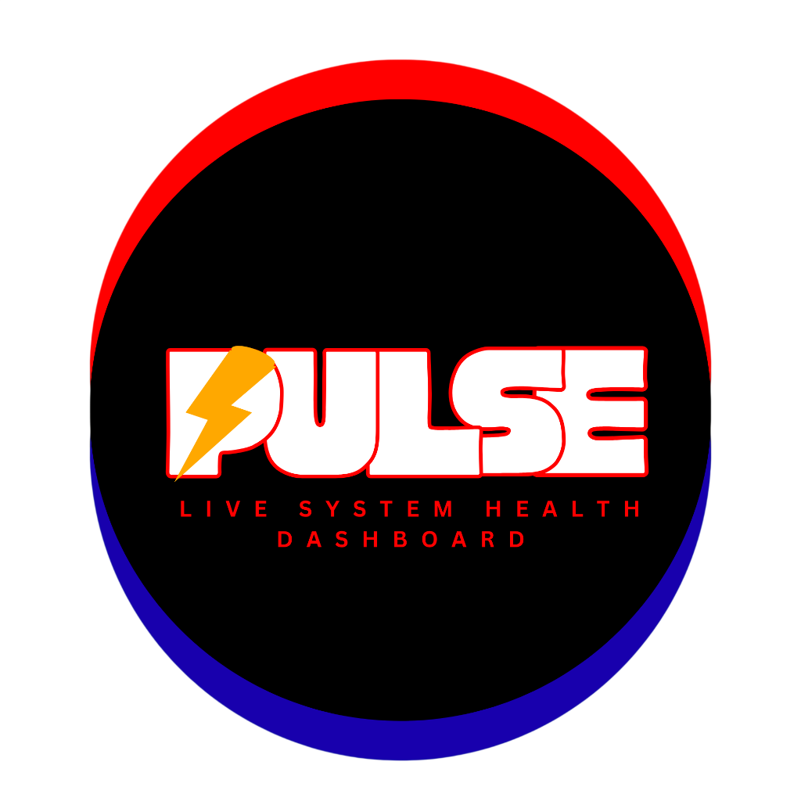

<p align="center">
  
</p>

<h1 align="center">PULSE</h1>

<p align="center">
  <strong>Know Your Machine. Own Your Performance.</strong><br>
  <em>Complete System Utility, Hardware Diagnostics & Performance Monitoring Suite for Windows 10 (22H2+) & Windows 11</em>
</p>

<p align="center">
  
  
  
  
  
</p>

---

## 📍 Direct Application Launch (.exe)

PULSE is pre-compiled as an optimized, standalone Windows native application ready to run without installing background services or external databases:

| File Location | Path | Size |
| :--- | :--- | :--- |
| **Root Executable (Recommended)** | [`pulse.exe`](file:///d:/projects%20and%20certificates/projects/uilities%20and%20others/PULSE/pulse.exe) | ~6.8 MB |
| **Target Release Build** | [`src-tauri/target/release/pulse.exe`](file:///d:/projects%20and%20certificates/projects/uilities%20and%20others/PULSE/src-tauri/target/release/pulse.exe) | ~6.8 MB |

```powershell
# Launch directly from the root folder:
.\pulse.exe
```

---

## 🚀 Product Overview

**PULSE** unites the core utilities of:
- **Windows Task Manager**: Live thread and working-set memory monitoring with safety guardrails protecting critical Windows services.
- **Hardware Monitoring (HWMonitor/HWiNFO style)**: Deep core-by-core loads, frequencies, thermals, and multi-vendor GPU telemetry.
- **System Diagnostics**: Complete motherboard, BIOS firmware, RAM module bank/speed details, and one-click PDF/CSV report export.
- **Storage Analytics**: SSD/HDD technology detection, SMART integrity checks, partition capacity warnings (<12% free).
- **Network Intelligence**: Live MB/s inbound/outbound speed meters, adapter MACs, IP routing, and ping latency telemetry.
- **Benchmarking Suite**: Controlled CPU single/multi-thread compute tests, memory throughput, and non-destructive sequential storage tests.
- **Gaming Mode & Floating HUD**: Translucent, movable, always-on-top desktop widget for in-game telemetry without invasive anti-cheat hooks.

> **Zero Simulated Metrics Rule**: Every figure displayed in PULSE originates from real Windows performance APIs, COM/WMI interfaces, or low-overhead kernel telemetry. If a hardware vendor does not expose a sensor, PULSE clearly denotes it as unavailable.

---

## 🎨 Visual Identity

PULSE features a technical, high-contrast dark visual identity built for clarity:

- **Primary Background**: `#101216`
- **Sidebar Surface**: `#161A20`
- **Cards & Widgets**: `#1C222B`
- **Dividers & Borders**: `#2A3442`
- **Primary Accent**: `#00D4FF` (Pulse Cyan)
- **Secondary Accent**: `#7C83FF` (Cobalt Indigo)
- **Success / Nominal**: `#35D07F` (Emerald)
- **Warning / Degraded**: `#FFB547` (Amber)
- **Critical / Low Space**: `#FF5252` (Crimson)
- **Primary Text**: `#F4F6F8`
- **Muted Text**: `#929BA8`

---

## 📦 Detailed Module Architecture

### 1. Module 01: System Overview Dashboard
- **Health Score Algorithm**: Aggregates CPU load, memory pressure, thermal readings, and storage capacity into a 0–100 score (`Optimal`, `Good`, `Warning`, `Critical`).
- **Core Telemetry Cards**: 6 key metric cards for CPU, RAM, GPU, Primary Disk, Network, and Thermals.
- **Interactive Graphs**: Real-time Apache ECharts history timelines with smooth area gradients.
- **Alert Feed**: Displays active system anomalies with one-click navigation to the alert center.

### 2. Modules 02 & 03: Advanced CPU & Memory Monitoring
- **Core Utilization Matrix**: CoreBarChart visualizer displaying utilization across every logical processor.
- **Processor Specs**: Core count, logical thread count, base clock, and dynamic clock speeds.
- **Physical Memory Breakdown**: Active working-set RAM, standby cache, and free memory.
- **Pagefile / Swap**: Dedicated virtual memory utilization tracking.
- **Top Memory Hogs**: Identifies non-system applications consuming high working-set RAM.

### 3. Module 04: GPU Monitoring
- **Multi-Vendor Support**: DirectX and WMI integration covering NVIDIA, AMD Radeon, and Intel Arc GPUs.
- **VRAM Tracking**: Dedicated VRAM capacity and dynamic allocation metering.
- **OEM Sensor Grace**: Clearly denotes when proprietary metrics (such as junction thermals or board wattage) require proprietary vendor drivers.

### 4. Module 05: Storage Monitoring
- **Device Identification**: SSD vs. HDD media distinction across all attached fixed and removable drives.
- **Capacity Warnings**: Dynamic warning indicators when partition free space drops below 12%.
- **SMART Health Status**: Evaluates filesystem tables and disk sector states.

### 5. Module 06: Network Intelligence
- **Bandwidth Telemetry**: Live download and upload speed meters with MB/s area charts.
- **Adapter Directory**: Enumeration of active Wi-Fi, Ethernet, and virtual network adapters.
- **Connectivity State**: IPv4 connection status, MAC address, and real-time ICMP ping latency.

### 6. Module 07: Process Manager
- **Live Process Table**: PID, Executable Name, Working-Set RAM, CPU %, Disk I/O, User, and Path.
- **System Process Protection**: Critical Windows processes (`csrss.exe`, `lsass.exe`, `smss.exe`, `services.exe`, `wininit.exe`, `explorer.exe`, `dwm.exe`, etc.) are protected from accidental termination.
- **Two-Step Confirmation**: Destructive user confirmations for terminating applications.

### 7. Module 08: Startup Manager
- **Hives Enumerated**: `HKCU\Software\Microsoft\Windows\CurrentVersion\Run`, `HKLM\...`, and Windows user Startup Folders.
- **Safe Toggle**: Enables or disables startup applications while preserving original execution parameters.

### 8. Modules 09 & 10: Hardware Diagnostics & Performance Insights
- **Motherboard & BIOS**: Manufacturer, product board model, serial number, BIOS firmware version, and release date.
- **CPU Capabilities**: AVX2, FMA3, AES-NI, Virtualization (VT-x/AMD-V), and SSE4.2 flags.
- **RAM Modules**: Bank labels, MT/s speed ratings, and module part numbers.
- **One-Click System Report**: Instant client-side export to formatted **PDF** (via jsPDF) and **CSV** files.
- **Measurement-Based Recommendations**: Identifies resource-hogging background tasks without automated registry cleaners.

### 9. Module 11: Benchmarking Center
- **CPU Single-Thread Benchmark**: Deterministic prime sieve testing single-core throughput.
- **CPU Multi-Thread Benchmark**: Parallel thread-pool compute workload utilizing all available logical threads.
- **Memory Bandwidth Benchmark**: Sequential read/write throughput (MB/s) and memory access latency (ns).
- **Storage Benchmark**: Sequential read and write speed test using controlled temporary files (`%TEMP%\pulse_benchmark_temp.dat`) guaranteed to be deleted immediately upon completion.
- **History & Comparison**: Saves all benchmark runs to SQLite with JSON export.

### 10. Module 12: Gaming Mode & Desktop HUD
- **In-Game Telemetry**: Framerate readiness, frame-time latency, GPU load, and thermals.
- **Translucent Desktop HUD**: Movable, resizable, always-on-top floating monitor widget.
- **Non-Invasive Policy**: Complies with BattlEye, Easy Anti-Cheat, and Vanguard anti-cheat engines (no DLL injection).

### 11. Module 13: Smart Alert System
- **Threshold Sliders**: Configurable trigger thresholds for CPU load, RAM usage, thermals, and storage space.
- **Anti-Spam Cooldowns**: Prevents notification fatigue by enforcing minimum alert intervals.
- **Incident History**: Logs all alert triggers to SQLite with dismissal options.

### 12. Modules 14 & 15: Historical Analytics & System Snapshots
- **Time Horizons**: Trend visualization over 1 hour, 24 hours, and 7 days.
- **State Snapshots**: Capture complete system telemetry snapshots with custom labels.
- **Side-by-Side Differential Compare**: Compares resource variance between baseline and active states.

### 13. Module 16: Settings & Customization
- **Polling Intervals**: Configurable monitoring frequency (500ms, 1000ms, 2000ms, 5000ms).
- **SQLite Data Retention**: Configurable history pruning (7, 30, 90, 365 days).
- **Color Themes**: Pulse Cyan, Cobalt Indigo, Emerald, and Amber Glow.
- **HUD Settings**: Always-on-top toggle and window opacity slider (30% to 100%).

---

## 🛠️ Technology Stack

| Layer | Technologies |
| :--- | :--- |
| **Desktop Framework** | [Tauri 2](https://v2.tauri.app/) (Native Windows container) |
| **Backend Engine** | Rust 2021 (`sysinfo`, `windows-rs`, `wmi`, `tokio`, `parking_lot`) |
| **Database** | Embedded SQLite with WAL mode (`rusqlite`) |
| **Frontend Framework**| React 19, TypeScript 6, Vite, Tailwind CSS v4 |
| **Visual Charts** | Apache ECharts (`echarts-for-react`) |
| **Motion & Transitions**| Framer Motion |
| **Icons** | Lucide React |
| **State Management** | Zustand |
| **Document Export** | jsPDF, jspdf-autotable |
| **Test Harness** | Vitest, React Testing Library, Cargo Rust test harness |

---

## 🧪 Testing & Verification

### Running Frontend Tests (Vitest)
```powershell
npm test
```
```
✓ src/utils/format.test.ts (6 tests)
✓ src/components/common/MetricBadge.test.tsx (2 tests)

Test Files  2 passed (2)
     Tests  8 passed (8)
```

### Running Backend Tests (Cargo)
```powershell
cargo test --lib --manifest-path src-tauri/Cargo.toml
```
```
running 1 test
test processes::tests::test_protected_processes ... ok

test result: ok. 1 passed; 0 failed; 0 ignored; 0 measured; 0 filtered out
```

---

## 💻 Building from Source

### Prerequisites
- Windows 10 (22H2+) or Windows 11
- Node.js 18+ and npm
- Rust 1.75+ (Cargo)

### Step 1: Install Dependencies
```powershell
npm install
```

### Step 2: Development Mode (Hot-Reload)
```powershell
npm run tauri dev
```

### Step 3: Production Release Compilation
```powershell
npm run build
cargo build --release --manifest-path src-tauri/Cargo.toml
```

---

## 🔒 Security & Safe Operation

- **No Administrator Obligation**: PULSE runs in standard user mode for monitoring, diagnostics, and benchmarking.
- **Process Guardrails**: Windows system services (`smss.exe`, `csrss.exe`, `lsass.exe`, `wininit.exe`, `explorer.exe`) cannot be terminated via PULSE.
- **Temporary File Cleanup**: Storage benchmarks exclusively write to a controlled temporary file in `%TEMP%` and remove it immediately after testing.
- **Local Persistence**: All SQLite databases (`%APPDATA%\PULSE\pulse_data.db`) are stored locally on your machine with zero cloud connectivity.

---

## 📄 License

Proprietary / All Rights Reserved. PULSE System Utility & Diagnostics Suite.
