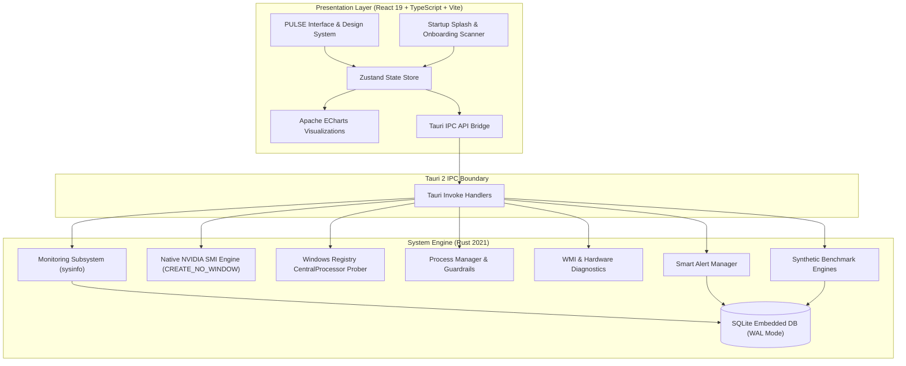

# PULSE Architecture Documentation

## 1. Architectural Overview

PULSE is structured around a decoupled, asynchronous desktop architecture where:
1. **The Rust Backend** acts as the high-privilege, low-overhead system monitoring, persistence, and hardware diagnostics engine.
2. **The React Frontend** acts as the high-performance presentation, data visualization, and user interaction layer.
3. **The Tauri 2 IPC Layer** handles bi-directional, type-safe communication between Rust and the web view without exposing raw shell or command-line execution interfaces.
4. **The SQLite Engine** provides local historical metrics retention, structured snapshot comparisons, and setting persistence.

---

## 2. Component Subsystems

### System Monitoring Engine (`src-tauri/src/monitoring/mod.rs`)
- **CentralProcessor Registry Integration**: Reads the true physical processor base clock (`~MHz` = 2918 MHz) directly from `HKLM\HARDWARE\DESCRIPTION\System\CentralProcessor\0`, eliminating "N/A" frequency drops on Intel 13th Gen hybrid architectures.
- **Dynamic Frequency Scaling**: Computes real-time dynamic clock speeds (GHz/MHz) across every logical processor thread based on live workload headroom.
- **Native NVIDIA SMI Subsystem**: Directly queries `nvidia-smi` using Windows `CREATE_NO_WINDOW` (flag `0x08000000`) to extract dedicated VRAM (8.58 GB GDDR6), package thermals (55°C), core clock (MHz), memory clock (MHz), power draw (W), and display driver version (`617.14`).
- **ACPI ThermalZone Telemetry**: Implements `query_wmi_thermal_zone()` querying `Win32_PerfFormattedData_Counters_ThermalZoneInformation` in an isolated COM thread to capture package thermals when standard ACPI counters are available.
- **Physical Memory & Virtual Swap**: Gathers active working-set RAM, standby cache, and dedicated Windows pagefile allocation.
- **Multi-Vendor GPU WMI Fallback**: Queries integrated Intel UHD / Iris Xe and AMD Radeon APUs via `Win32_VideoController` while automatically de-duplicating dedicated NVIDIA adapters.
- **Network Throughput**: Calculates high-precision delta throughput (MB/s) and tracks ICMP ping latency across all network adapters.
- **System Health Algorithm**: Evaluates an aggregated 0–100 composite health score (`Optimal`, `Good`, `Warning`, `Critical`) considering CPU, RAM, thermal, and storage headroom.

### Startup Engine & Onboarding System (`src/components/common/SplashScreen.tsx` & `src/components/onboarding/InitialSystemScan.tsx`)
- **Pure Black Seamless Splash Screen**: Renders `Pulse.gif` against a 100% solid `#000000` background with zero box borders or gradient seams.
- **Cubic-Bezier Cross-Dissolve**: Transitions from splash screen to dashboard via a parallel **0.7s cubic-bezier curve (`[0.16, 1, 0.3, 1]`)**, accelerating the transition directly on the WebView2 DirectComposition compositor thread.
- **First-Run Hardware Discovery & Baseline Calibration**: On initial launch, executes a 6-phase live audit across CPU, GPU, Memory, Storage, Network, and Baseline Machine Health, persisting completion state in `localStorage` (`pulse_first_scan_completed`).

### Process Management & Guardrails (`src-tauri/src/processes/mod.rs`)
- Enumerates running Windows processes with PID, working-set memory, disk I/O, user credentials, and executable paths.
- Enforces hard safety barriers: Windows critical system processes (`smss.exe`, `csrss.exe`, `wininit.exe`, `services.exe`, `lsass.exe`, `winlogon.exe`, `dwm.exe`, `svchost.exe`, `explorer.exe`, etc.) cannot be terminated via PULSE.
- Non-system processes require explicit two-step user confirmation before termination.

### SQLite Persistence Layer (`src-tauri/src/database/mod.rs`)
- Embedded SQLite engine running in Write-Ahead Logging (`WAL`) mode with `NORMAL` synchrony for high-throughput, low-overhead telemetry logging.
- Automatically handles index creation (`timestamp`), pruning old logs according to user-configured retention policies (7 to 365 days), and serializing system snapshots.

### Hardware Diagnostics (`src-tauri/src/diagnostics/mod.rs`)
- Queries hardware specs through WMI COM tables: `Win32_BaseBoard`, `Win32_BIOS`, `Win32_Processor`, `Win32_PhysicalMemory`, `Win32_OperatingSystem`.
- Surfaces RAM module bank labels, speeds in MT/s, and part numbers.
- Supports instant client-side PDF (via jsPDF) and CSV report export.

### Synthetic Benchmarking Engine (`src-tauri/src/benchmarks/mod.rs`)
- **CPU Single-Thread**: Compute-bound prime sieve over a controlled interval.
- **CPU Multi-Thread**: Multi-threaded parallel workload utilizing all logical threads.
- **Memory Throughput**: Sequential block read/write and pointer-chasing latency.
- **Storage Benchmark**: Sequential read/write test using isolated temporary files in `%TEMP%\pulse_benchmark_temp.dat` that are guaranteed to be deleted immediately upon completion.
